# Integration of the Cosine Variation and Adaptive Levy Flight for the Cuckoo Optimization Algorithm, Improving the Cuckoo, MATLAB Code

If the image cannot be displayed, please move to gzh: Taojia Code.

Frequently, friends in the back will ask: 
"Can the algorithm improved by the author be used for writing papers?"
The answer is: Of course! No need to add references!
If my article can help everyone write papers, it would be a great honor for the author!
Detailed Explanation
Basic Cuckoo Search Algorithm Principles:
The basic cuckoo search algorithm (Cuckoo Search algorithm, CS) solves optimal solutions by simulating the behavior of cuckoo birds searching for nests and laying eggs. The solving process is as follows:
1) Set the population size, abandonment rate, problem boundaries, and maximum iteration times.
2) Randomly generate a certain number of populations within the problem domain and calculate the objective function value of each individual, finding the current optimal value and optimal solution.
3) Determine whether the iteration count has reached the maximum iteration count. If so, exit the loop and output the optimal value and optimal solution; otherwise, proceed to step 4).
4) Update the bird's nest according to the following formula:
In the formula: nest(t+1)i,nestti represent the position of the i-th bird's nest at the t+1 and t generations respectively; α=0.01R, R∈N(0,1); best represents the best position of the current bird's nest; step represents the step length generated by Levy flight.
In the formula: β takes the value of 1.5; ν,μ∈N(0,1); φ is calculated as follows:
5) Calculate the objective function value of the new bird's nest, if it is superior to the previous one, replace the function value and corresponding bird's nest, and record the optimal solution.
6) Randomly generate a number between 0 and 1 and compare it with the abandonment rate. If less than, keep the bird's nest, otherwise generate a new bird's nest according to the following formula:
In the formula: a,c are unique random integers not repeated in the tth iteration; r∈[0,1] random number.
7) Recalculate the objective function value of the new bird's nest, if it is superior to the previous one, replace the function value and corresponding bird's nest, and record the optimal solution.
8) Judge the function value and optimal value, if less than, replace the optimal value and optimal solution; The algorithm enters step 3) for the next iteration.
Improvement of the Cuckoo Search Algorithm:
Improvement point 1: On the basis of the basic Cuckoo Search algorithm, adopt a tent chaos map to initialize the diversity of the population.
Improvement point 2: Use an adaptive step length Levy flight to improve the update formula for the nest.
Improvement point 3: Before random walk, first use the Cauchy mutation to update the nest position. The Cauchy distribution is similar to the standard normal distribution, which is a continuous probability distribution with small values at the origin, relatively flat and long on both ends, approaching zero rate slowly, so it can generate greater perturbation compared to the previous random walk strategy. Therefore, using Cauchy mutation to perturb the nest position can expand the search scale of the Cuckoo Search Algorithm, thereby enhancing the ability of the algorithm to escape from local optima.
Results Display:
Tested on the CEC2005 function set, the results are as follows: Among them, CALCS is the improved Cuckoo Search Algorithm proposed in this paper, CS is the original Cuckoo Optimization Algorithm, GWO is the Grey Wolf Optimization Algorithm, PSO is the Particle Swarm Optimization Algorithm.
The algorithm iterates 1000 times, each algorithm sets the number of particles at 30.
Result analysis: In the tests of single peak function and multi-peak function, it can be seen that the Cuckoo Optimization Algorithm with integrated Cauchy mutation and adaptive Levy flight indeed has good optimization effect!
Code Display
function [bestnest,fmin,lhy]=CS(n,N_IterTotal,lb,ub,nd,fobj)\npa=0.25;              % Discovery rate of alien eggs/solutions\n%% Simple bounds of the search domain\nLb=lb.*ones(1,nd);     % Lower bounds\nUb=ub.*ones(1,nd);      % Upper bounds\n% Random initial solutions\nnest=initialization(n,nd,Ub,Lb);\n% Get the current best of the initial population\nfitness=10^10*ones(n,1);\n[fmin,bestnest,nest,fitness]=get_best_nest(nest,nest,fitness,fobj);\n%% Starting iterations\nfor iter=1:N_IterTotal\n    % Generate new solutions (but keep the current best)\n     new_nest=get_cuckoos(nest,bestnest,Lb,Ub);   \n     [fnew,best,nest,fitness]=get_best_nest(nest,new_nest,fitness,fobj);\n    % Discovery and randomization\n      new_nest=empty_nests(nest,Lb,Ub,pa) ;\n    % Evaluate this set of solutions\n      [fnew,best,nest,fitness]=get_best_nest(nest,new_nest,fitness,fobj);\n    % Find the best objective so far  \n    if fnew<fmin\n        fmin=fnew;\n        bestnest=best;\n    end \n    lhy(iter) = fmin;\nend %% End of iterations\n​\n%% --------------- All subfunctions are list below ------------------\n%% Get cuckoos by ramdom walk\nfunction nest=get_cuckoos(nest,best,Lb,Ub)\n% Levy flights\nn=size(nest,1);\n% For details about Levy flights, please read Chapter 3 of the book:\n% X. S. Yang, Nature-Inspired Optimization Algorithms, Elesevier, (2014).\nbeta=3/2;\nsigma=(gamma(1+beta)*sin(pi*beta/2)/(gamma((1+beta)/2)*beta*2^((beta-1)/2)))^(1/beta);\nfor j=1:n\n    s=nest(j,:);\n    % This is a simple way of implementing Levy flights\n    % For standard random walks, use step=1;\n    %% Levy flights by Mantegna's algorithm\n    u=randn(size(s))*sigma;\n    v=randn(size(s));\n    step=u./abs(v).^(1/beta);\n  \n    % In the next equation, the difference factor (s-best) means that \n    % when the solution is the best solution, it remains unchanged.     \n    stepsize=0.01*step.*(s-best);\n    % Here the factor 0.01 comes from the fact that L/100 should be the\n    % typical step size for walks/flights where L is the problem scale; \n    % otherwise, Levy flights may become too aggresive/efficient, \n    % which makes new solutions (even) jump out side of the design domain \n    % (and thus wasting evaluations).\n    % Now the actual random walks or flights\n    s=s+stepsize.*randn(size(s));\n    % Apply simple bounds/limits\n    nest(j,:)=simplebounds(s,Lb,Ub);\nend\n%% Find the current best solution/nest among the population\nfunction [fmin,best,nest,fitness]=get_best_nest(nest,newnest,fitness,fobj)\n% Evaluating all new solutions\nfor j=1:size(nest,1)\n    fnew=fobj(newnest(j,:));\n    if fnew<=fitness(j)\n       fitness(j)=fnew;\n       nest(j,:)=newnest(j,:);\n    end\nend\n% Find the current best\n[fmin,K]=min(fitness) ;\nbest=nest(K,:);\n%% Replace some not-so-good nests by constructing new solutions/nests\nfunction new_nest=empty_nests(nest,Lb,Ub,pa)\n% A fraction of worse nests are discovered with a probability pa\nn=size(nest,1);\n% Discovered or not -- a status vector\nK=rand(size(nest))>pa;\n% Notes: In the real world, if a cuckoo's egg is very similar to \n% a host's eggs, then this cuckoo's egg is less likely to be discovered. \n% so the fitness should be related to the difference in solutions.  \n% Therefore, it is a good idea to do a random walk in a biased way \n% with some random step sizes.  \n%% New solution by biased/selective random walks\nstepsize=rand*(nest(randperm(n),:)-nest(randperm(n),:));\nnew_nest=nest+stepsize.*K;\nfor j=1:size(new_nest,1)\n    s=new_nest(j,:);\n  new_nest(j,:)=simplebounds(s,Lb,Ub);  \nend\n% Application of simple bounds/constraints\nfunction s=simplebounds(s,Lb,Ub)\n  % Apply the lower bound\n  ns_tmp=s;\n  I=ns_tmp<Lb;\n  ns_tmp(I)=Lb(I);\n  \n  % Apply the upper bounds \n  J=ns_tmp>Ub;\n  ns_tmp(J)=Ub(J);\n  % Update this new move \n  s=ns_tmp;\n%% You can replace the following objective function\n%% by your own functions (also update the Lb and Ub)\n​\n  

## Images

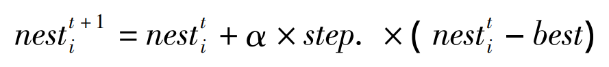
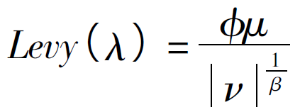
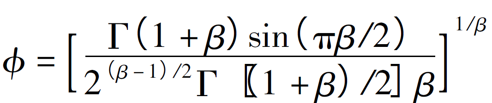
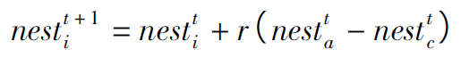
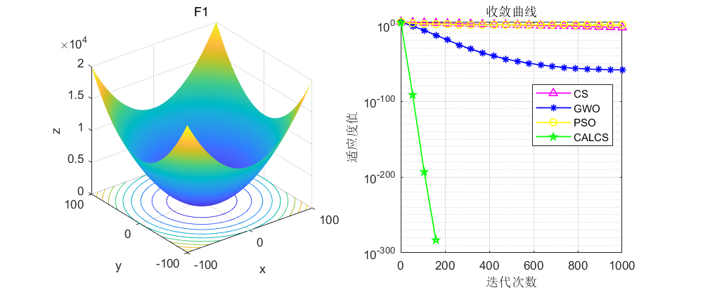
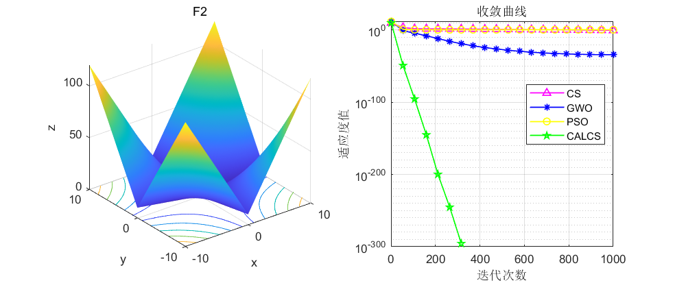
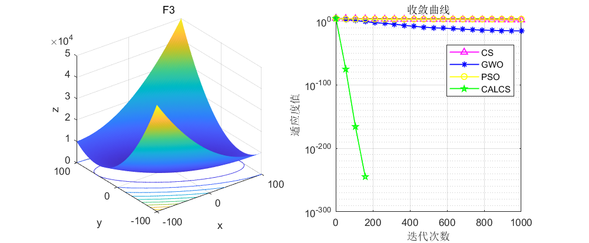
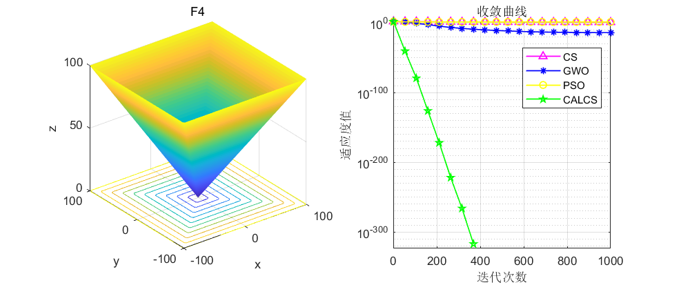
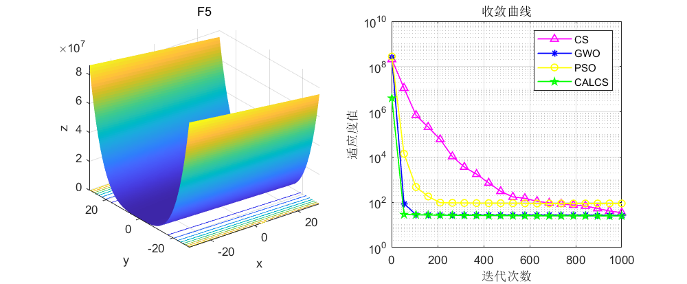
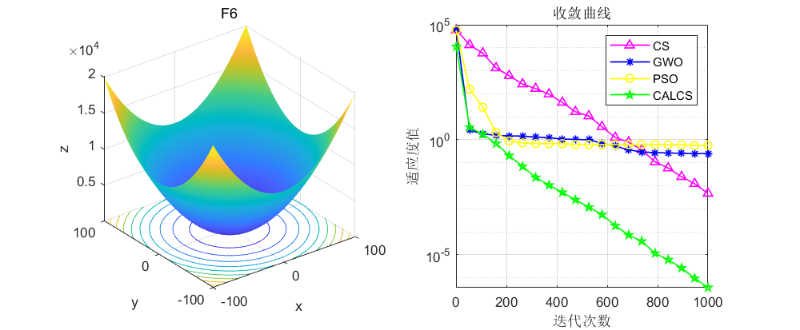
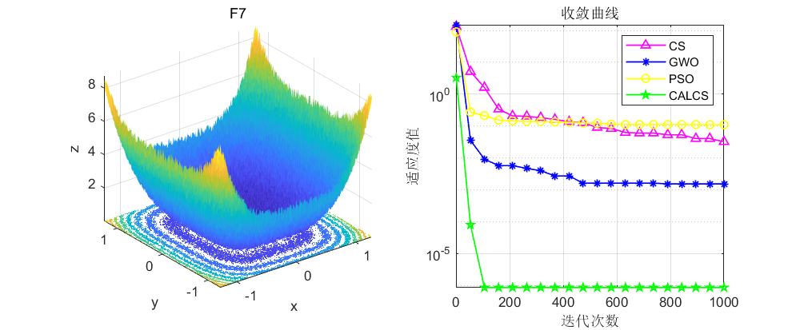
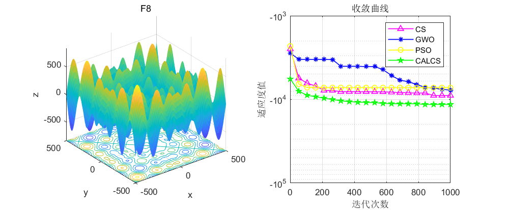
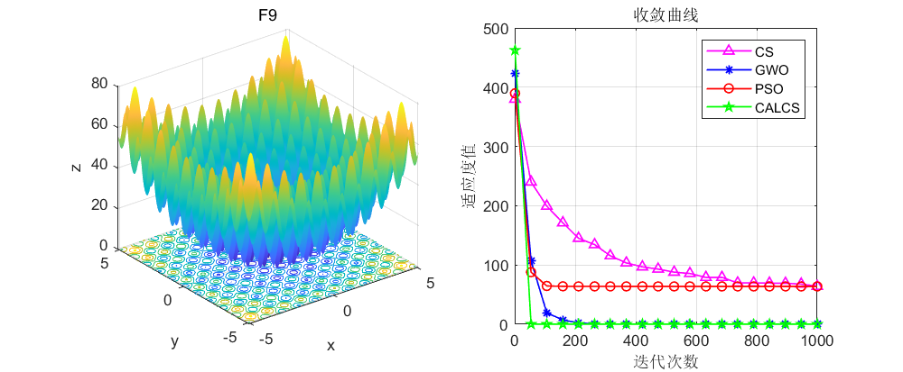
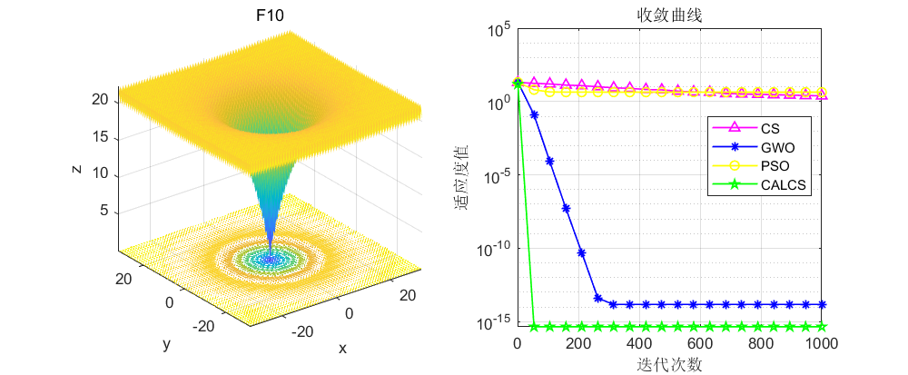

<!-- PAYMENT_BLOCK -->

## Get this dataset

- Payment link (Stripe): [Buy now](https://buy.stripe.com/3cs8yP7sY87d0vu9AB)
- Payment QR code: 

<!-- /PAYMENT_BLOCK -->
